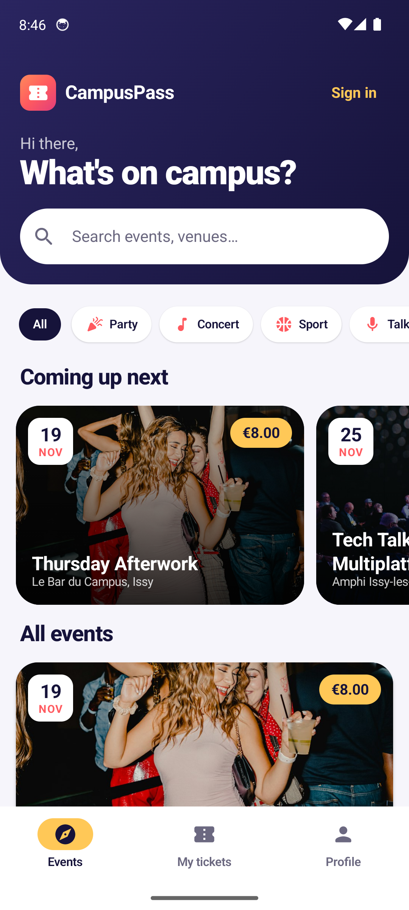
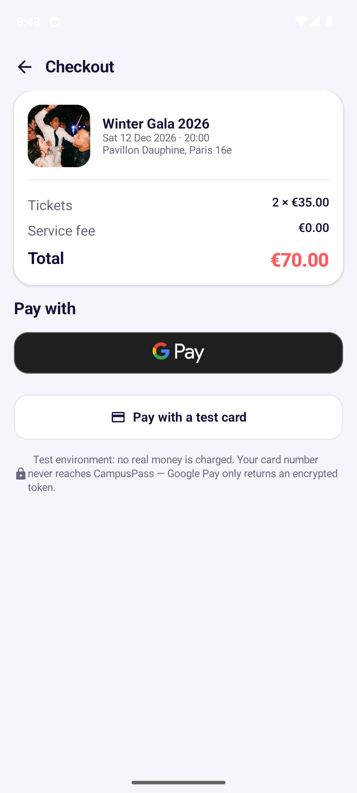
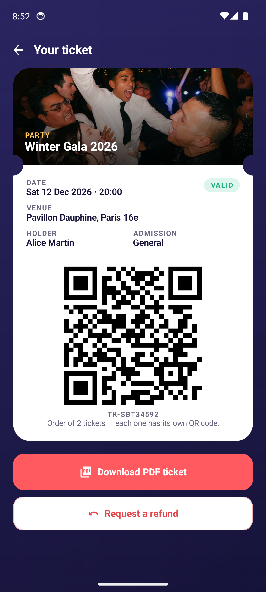
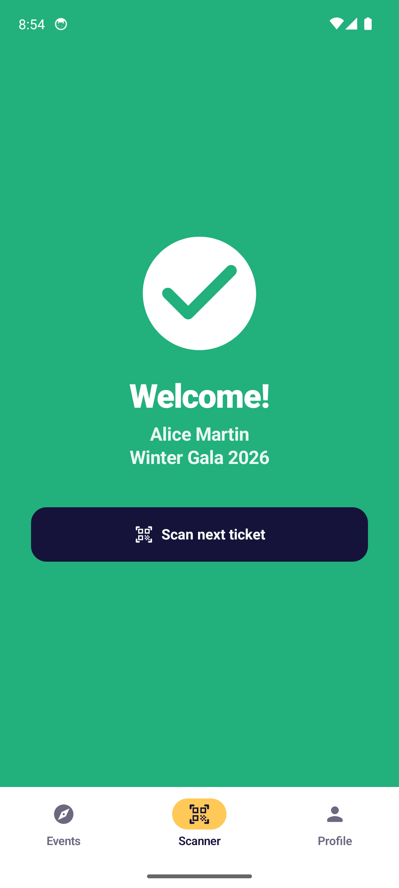
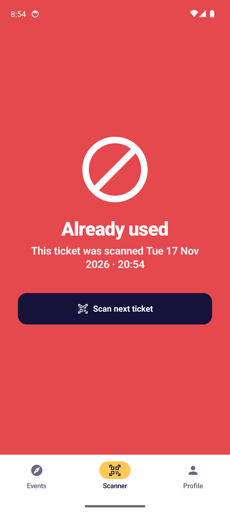

# CampusPass — Mobile payments & secure transactions

**II.3510 Mobile Application Development for Android — A3 2026-2027 — Students presentations (Skills)**
**Topic:** Mobile payments & secure transactions (Google Pay test mode, biometric confirmation, signed QR-code tickets, PDF receipts)
**Author:** Mouhamadou Soukhouna

CampusPass is a ticketing app for student events (galas, concerts, sport, talks, trips).
Students buy tickets with **Google Pay**, confirm the payment with their **fingerprint**, and receive a
**cryptographically signed, single-use QR code**. Organizers scan the tickets at the entrance:
a valid ticket shows a green "Welcome!", the same ticket scanned again shows a red "Already used".

| Events | Checkout | Ticket | Scan OK | Scan again |
|---|---|---|---|---|
|  |  |  |  |  |

- Unfinished project for classmates: https://github.com/mouhamedprogramer/II.3510_2627_Skills_MobilePayments_UP

## Features

| Feature | Technology |
|---|---|
| Event catalog: search, category filter, featured events, seats left, sold out | Jetpack Compose, `LazyColumn` / `LazyRow`, StateFlow |
| Checkout with **Google Pay** (TEST environment, no real money) | `play-services-wallet` (Google Pay API v2), `compose-pay-button` |
| Fallback **test card** form when Google Pay is unavailable (emulator without Google account) | Compose bottom sheet |
| **Biometric confirmation** before every payment (fingerprint / face / device PIN) | `androidx.biometric` `BiometricPrompt` |
| **Signed QR-code tickets**: HMAC-SHA256 signature, impossible to forge | ZXing `QRCodeWriter`, `javax.crypto.Mac` (expect/actual) |
| **Entrance scanner** for organizers: camera, picture or manual code; single use | `zxing-android-embedded` `ScanContract`, ZXing `QRCodeReader` |
| Scan answers: ✅ Welcome · ⛔ Already used · ⛔ Refunded · ⚠️ Wrong event · ⛔ Forged | Domain `ScanResult` sealed interface |
| **Refunds** up to 48 h before the event (seats are released) | Domain rule + unit tests |
| **PDF e-ticket + receipt** (one page per ticket with its QR code, then the receipt) | `android.graphics.pdf.PdfDocument`, `FileProvider` |
| Purchase history, total spent, max brightness while showing a ticket | Compose, `WindowManager.LayoutParams` |

## Demo accounts

| Role | E-mail | Password |
|---|---|---|
| Student | alice@isep.fr | alice123 |
| Student | bob@isep.fr | bob123 |
| Organizer (scanner) | bde@isep.fr | bde123 |

## Run it

Requirements: Android Studio, Android SDK 36, an emulator or a device running Android 8.0+ (API 26).
The emulator image must include **Google APIs** (Google Play services) for Google Pay.

```bash
./gradlew :composeApp:installDebug   # build & install
./gradlew :shared:jvmTest            # 15 unit tests of the business rules
```

**Google Pay** opens its real payment sheet in TEST mode. It needs a Google account signed in on the device
(Settings › Passwords & accounts). Without it, use **"Pay with a test card"** (`4242 4242 4242 4242`).

**Biometrics on the emulator:** Settings › Security › add a PIN, then Fingerprint; touch the sensor from
*Extended controls › Fingerprint*. Without enrolled biometrics the app asks to continue in demo mode.

**Scanning on the emulator:** take a screenshot of a ticket, then in the Scanner tab use *From a picture*.
On a real phone, use *Scan ticket* (camera).

## Architecture

```
CampusPass/
├── shared/                         Kotlin Multiplatform module, no Android UI
│   ├── commonMain/
│   │   ├── domain/                 Event, Ticket, Transaction, PaymentReceipt, ScanResult, TimeSource
│   │   ├── security/TicketSigner   HMAC-SHA256 signing / verification of QR codes (expect fun hmacSha256)
│   │   └── repository/             AuthRepository, EventRepository, TicketingRepository (all business rules)
│   ├── androidMain / jvmMain       actual hmacSha256 with javax.crypto
│   └── commonTest/                 PurchaseTest, RefundTest, ScanTest
└── composeApp/                     Android app (Jetpack Compose, MVVM)
    ├── payment/GooglePay.kt        Google Pay JSON requests + PaymentsClient (TEST)
    ├── security/BiometricAuthenticator.kt
    ├── qr/QrCodes.kt               QR generation & decoding (ZXing)
    ├── pdf/TicketPdfGenerator.kt   PDF ticket & receipt
    ├── viewmodel/                  one ViewModel per screen (StateFlow, Loading/Success/Error)
    └── ui/                         screens, components, theme, navigation
```

- **MVVM**: screens observe `StateFlow`s exposed by ViewModels; ViewModels only talk to repositories.
- **Business rules in the domain** (`TicketingRepository`): max 4 tickets per order and per student, seats left,
  no purchase after the event start, payment token required, refund only by the buyer and ≥ 48 h before,
  single-use validation. They are covered by unit tests that run on the JVM.
- **Platform services stay in the UI/data layer** (Google Pay, BiometricPrompt, camera, PDF): the domain only
  receives a `PaymentReceipt(method, token)`.

### Payment flow

```
[Get tickets] → Checkout → BiometricPrompt ✔ → Google Pay sheet (TEST) → encrypted token
     → TicketingRepository.purchase(user, event, qty, receipt)   (in production: server + PSP charge)
     → N tickets, each with a QR code = "CPASS1:<ticketId>:<eventId>:<HMAC>"
[Entrance] scan → TicketSigner.verify (signature) → ticket exists → right event → VALID? → mark USED
```

## Security notes (what would change in production)

- The HMAC secret and the ticket database must live **on a server**; the scanner app asks the server (or holds
  a public key with asymmetric signatures) instead of sharing a secret.
- The Google Pay token must be sent to the server and charged through a **payment service provider**
  (Stripe, Adyen…) in `PRODUCTION` mode, after Google Pay merchant registration.
- The app never sees the card number (Google Pay tokenization) nor the fingerprint (`BiometricPrompt` only
  returns success/failure).

## Credits

Event photos from [Unsplash](https://unsplash.com/license) (free license), loaded over the network.
